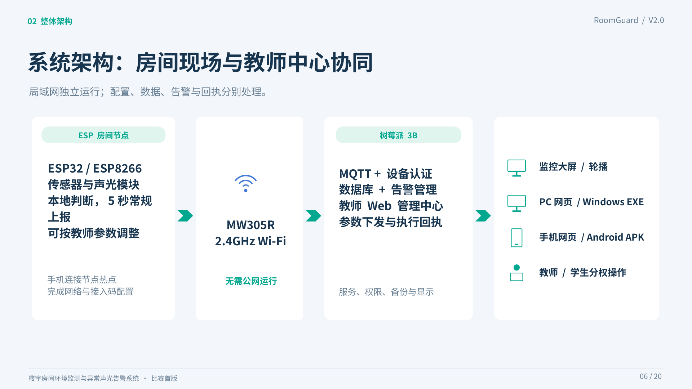

# RoomGuard：楼宇房间环境监测与异常声光告警系统

面向中职双人参赛项目的完整资料库：**系统工程、Arduino 固件、树莓派部署、教师教学、学生岗位学习手册及比赛展示资料**。

当前推荐 **V2**。实物基线为 **101＝ESP32、102＝ESP8266、树莓派 3B、MW305R 路由器**；同协议节点可经手机配网和管理者批准扩展。温湿度仅展示，烟雾或火焰触发对应房间本地声光。

## 先下载这三个包

| 资料包 | 用途 | 下载 |
| --- | --- | --- |
| 系统完整交付包 | 源码、固件、APK／EXE、手册、架构、PPT、测试证据 | [下载 V2 完整包](downloads/v2/RoomGuard_V2_完整交付包.zip?raw=1) |
| 教师教学资料包 | 36 学时、12 任务的项目化教学、任务单、评价与参考答案 | [下载教师教学包](downloads/v2/RoomGuard_V2_中职竞赛教学资料包.zip?raw=1) |
| 学生双岗位手册包 | A 系统操作、B 展示演讲及双人配合卡，提供 Word／PDF | [下载学生学习包](downloads/v2/RoomGuard_V2_参赛学生双岗位学习手册.zip?raw=1) |

文件已保存在本 GitHub 仓库，可在此下载，无需依赖原 Codex 会话下载链接。也可点击 **Code → Download ZIP** 获取整个资料库，或使用 `git clone https://github.com/kafeiwu2012/zzjs.git`。

## 按角色开始

- **辅导教师**：[教学指导手册 PDF](teaching/standalone/教师项目化教学指导手册_V2.pdf) · [可编辑 Word](teaching/standalone/教师项目化教学指导手册_V2.docx?raw=1) · [教师后台手册](manuals/教师后台操作手册_V2.pdf)。
- **学生 A／系统操作**：[学习手册 PDF](students/standalone/参赛学生A_系统操作学习手册_V2.pdf) · [可编辑 Word](students/standalone/参赛学生A_系统操作学习手册_V2.docx?raw=1)。
- **学生 B／展示演讲**：[学习手册 PDF](students/standalone/参赛学生B_展示演讲学习手册_V2.pdf) · [可编辑 Word](students/standalone/参赛学生B_展示演讲学习手册_V2.docx?raw=1)。
- **两人协作**：[比赛配合随身卡](students/standalone/双人比赛配合随身卡_V2.pdf) · [比赛 PPT](presentation/RoomGuard_V2_竞赛展示_教师后台与自适应节点.pptx?raw=1) · [PPT 预览 PDF](presentation/RoomGuard_V2_竞赛展示_教师后台与自适应节点.pdf)。
- **安装与开发**：[树莓派新手手册](manuals/树莓派新手部署与维护_V2.pdf) · [Arduino 与手机配网](manuals/ESP手机配网与Arduino烧录_V2.pdf) · [开发与重建](manuals/开发与重建指南_V2.pdf) · [可浏览源码](system/roomguard-v2/README.md)。

## 资料怎样组织

| 目录 | 内容 |
| --- | --- |
| [`system/roomguard-v2/`](system/roomguard-v2/) | V2 完整可浏览工程：服务、Arduino、客户端、部署、硬件草案、测试和文档 |
| [`manuals/`](manuals/) | 单独查阅／下载的系统需求、部署、维护、验收等 V2 文档 |
| [`teaching/`](teaching/) | 教师教学资料、学生任务单、评价与编辑源稿 |
| [`students/`](students/) | 两名学生各自的学习手册、配合卡及源稿 |
| [`presentation/`](presentation/) | V2 比赛 PPT、PDF 和页面总览 |
| [`downloads/v2/`](downloads/v2/) | V2 原交付压缩包、Arduino 包、基板参考包、APK 与 EXE |
| [`archive/`](archive/) | V1.0、V1.1 和早期汇总资料，保留历史参考 |
| [`docs/资料总目录.md`](docs/资料总目录.md) | 原有 93 份交付文件在仓库中的逐项位置 |
| [`CHECKSUMS.sha256`](CHECKSUMS.sha256) | 本仓库全部资料的 SHA256 校验清单 |

## 运行入口

开发先进入 `system/roomguard-v2/`。Pi 首次安装按新手手册执行 `sudo bash deploy/install.sh`；已有部署先备份，再使用升级流程。首次新装节点清单为空，配网并经教师批准后才出现房间。

- 工作台：`http://实际树莓派IP:8080/`
- 只读大屏：`http://实际树莓派IP:8080/?screen=1`
- 教师后台：`http://实际树莓派IP:8080/teacher`
- Arduino：`arduino/RoomGuard_ESP32/RoomGuard_ESP32.ino` 与 `arduino/RoomGuard_ESP8266/RoomGuard_ESP8266.ino`

两种芯片共用业务逻辑，**不能互刷同一个 BIN**。Windows EXE 使用系统 Edge；Android APK 面向 API22／Android5.1，后台行为须在指定手机实测。

## 验证范围与版本说明

已交付记录包含两平台 Arduino 编译、21 项自动测试、本地告警状态机、MQTT 集成及浏览器检查。它们不代替目标 Pi、ESP 电平与传感器、手机 AP、Windows 和 OPPO 锁屏的实物验收，详见[测试说明](manuals/测试与交付说明_V2.pdf)。本系统为教学演示原型。

基板仍为 **未布线审阅草案**，排距、模块尺寸／脚序等待核验，不能直接下单制造。网络恢复上报当前状态，不保证补齐完整离线历史。新 APK 开发签名与早期版本不同，必要时先卸载旧版。

公开上传排除了私钥、运行账号配置、数据库和缓存。早期三个归档 ZIP 中的上游 SSL 示例私钥已递归清理；旧校验记录仅作追溯，现上传字节以本仓库 `CHECKSUMS.sha256` 为准。可浏览 Pi 手册已校正为“首次创建服务器 MQTT 账号，节点凭据在批准时发放”。详见[上传与校验说明](docs/上传与校验说明.md)。

第三方库保留上游许可，见 [THIRD_PARTY.md](THIRD_PARTY.md) 和工程库目录。仓库没有另行替上游组件授予统一许可证。
