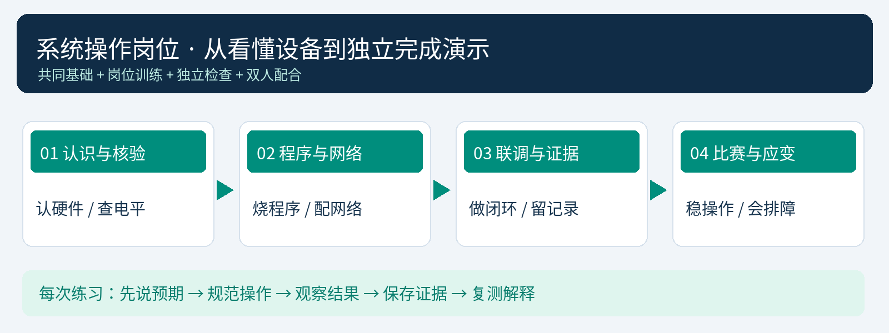

# 参赛学生A学习手册：系统操作

RoomGuard V2 楼宇房间环境监测与异常声光告警系统

姓名：____________　学校：____________　搭档B：____________　指导教师：____________



这本手册给负责系统操作的你使用。你的任务是把设备准备好、按口令完成演示、核对真实结果，并在异常时有顺序地检查。你也要能用自己的话解释原理，不能只会照按钮。

与36学时教学计划配套；按八个关卡逐步学习，不必一次背完。具体电路和首次部署仍对照V2硬件、Arduino及Pi手册。每次先写预期，再操作，最后留下证据。学校与比赛规则确定后，请教师调整时间、权限及允许的演示方式。

## 一、你与搭档怎样合作

你负责：设备识别与核对、供电与接线检查、Arduino上传、网络与Pi检查、手机配网、终端准备、告警操作、故障排查和比赛收尾。

搭档B负责：背景与需求、系统架构、技术说明、PPT与界面指示、下达清晰口令、根据结果讲解、记录时间和参与答辩。B也必须会查在线、做基本告警处置和说明配网流程；你也必须会一分钟介绍项目。

教师默认负责：电路核准、受控传感器测试方案、全局账号、设备接入批准、服务维护与恢复监督。若赛规要求学生独立配置，由教师提前准备专用演示环境和适当权限，不在现场临时越权或公开管理密码。

比赛配合方式：B先说明目标并下口令；你复述目标房间和动作；你操作；双方观察声光、页面及回执；B只讲已经看到的结果。未完成时准确说“正在等待”，不要为了接上讲稿提前说成功。

你要练会的三句话：

“我准备对____房间进行____操作，预期出现____。”

“本地已看到____，终端目前显示____，还在等待____。”

“当前证据支持____，我将先检查____，随后复测。”

## 二、两人都要懂的系统基础

### 1. 一条数据链和一条本地支路

DHT11／MQ-2／火焰模块→ESP32或ESP8266→MW305R路由器→树莓派3B→网页、大屏、Windows EXE和Android APK。

另一条支路：传感器→ESP本地判断→有源蜂鸣器与RGB。节点还有电、程序与输入正常时，本地报警不应依赖路由器、MQTT或Pi。服务器负责收集、存储、处理、记录和提供终端访问，不是所有报警必须经过的开关。

101房间使用ESP32；102房间使用ESP8266。设备ID识别具体板卡，房间号是教师绑定的位置，IP是网络地址。这三者不能互换。

### 2. 五类模块与电平

| 部件 | 你要理解的作用 | 容易弄错的地方 |
| --- | --- | --- |
| DHT11 | 读取温湿度，仅展示与保存 | DATA为数字协议，不是普通开关DO |
| MQ-2 | AO提供相对响应，DO提供阈值状态 | 需按器件要求5V供电并适配信号，未经标定不能称准确ppm |
| 火焰模块 | 检测相关光谱输入，提供DO状态 | 环境光、方向和距离会影响响应 |
| 有源蜂鸣器 | 本地声音提醒，本模块低电平触发 | GPIO是控制信号，不是任意大电流电源 |
| RGB模块 | 正常绿色，异常按固件闪烁提醒 | 核对公共端、限流和实际极性 |

ESP逻辑输入不能直接承受任意5V输出。模块电源与信号输入是两个问题，不能因为模块用5V就把AO／DO直接插ESP。MQ-2要预热；固件默认180秒只是开发参数，实际器件初次老化、稳定和阈值必须经教师核验。

### 3. 告警规则必须背熟并能解释

温湿度不触发本项目环境报警。烟雾或火焰任何一项触发对应房间声光；同时触发显示两个原因。异常持续则保持报警，全部原因正常并稳定N秒才解除，默认N=10秒，可由教师配置。

确认=管理员已看到；本次消音=当前事件蜂鸣停止但异常和红灯保留；解除=输入恢复并满足稳定时间。消音后新增原因或新事件应重新鸣叫。离线不继续显示正常，最后已知异常不能静默清除。

常规上报默认5秒；离线门限按实际生效上报周期4倍且至少20秒。页面默认约2秒查询一次，这不是本地烟火检测周期。本地判断不随上报改慢。

## 三、八个学习关卡

| 关卡 | 你要做成什么 | 留下什么证据 |
| --- | --- | --- |
| 1 认识与测量 | 找到模块、信号、供电和已核验转换电路 | 接线／测量核对表 |
| 2 Arduino烧录 | 分别选对两种芯片工程并上传 | 板型、端口与构建记录 |
| 3 网络与Pi | 找IP、SSH登录、检查服务与HTTP | 命令结果和解释 |
| 4 手机配网 | 识别AP、申请接入、绑定正确房间 | ID—房间映射与上线记录 |
| 5 告警闭环 | 完成触发、确认、消音、稳定恢复 | 四组合和时间线 |
| 6 终端与历史 | 准备三终端，核对声音和CSV | 设置表、导出样例 |
| 7 排查与维护 | 用证据定位并恢复可控故障 | 两份故障闭环记录 |
| 8 比赛执行 | 按口令完成演示及收尾 | 计时录像与个人复盘 |

每关练习三轮：第一轮看教师示范；第二轮对照清单操作；第三轮不看步骤完成并解释。关键操作达到第三轮后再签“独立完成”。

## 四、关卡1：认识实物与上电检查

先做：拍清实物丝印，查VCC、GND、DATA、AO、DO、I/O与R/G/B。传感器DO的字母O与ESP8266板标签D0的数字0不同，D0对应GPIO16。

两块板每侧15针、针距2.54mm，但引脚不相同，排距也不能由此推定。当前通用基板未布线，排距、脚序和尺寸仍待核验，不可直接下单。

| 逻辑信号 | ESP32 GPIO | ESP8266 GPIO／板标签 |
| --- | --- | --- |
| DHT DATA | 27 | 2／D4，需启动上拉 |
| MQ AO | 34／ADC1 | A0，实际量程须核验 |
| MQ DO | 26 | 14／D5 |
| 火焰DO | 25 | 12／D6 |
| 蜂鸣器控制 | 23 | 13／D7 |
| RGB R／G／B | 18／19／21 | 4／5／16，D2／D1／D0 |

这是ESP逻辑侧映射，不是让你把5V模块直接接脚。原型与基板参考分压不同，node_options.h及运行硬件模板必须与实际电路对应。

上电前六查：断电；板卡方向与引脚正确；供电及共地正确；转换电路与电阻已核准；无短路／松线；教师复核。断电才能改线、测电阻或通断；直流电压测量按教师示范，不把电流档跨在电源两端。

你应会算：Vout=Vin×R下/(R上+R下)。例如理想5V经上20kΩ、下10kΩ得到约1.67V；这不自动证明未知ESP8266板A0安全，还要核验量程、容差与最高输入。

本关过关：你能指出一条5V信号怎样安全进入ESP，并解释为什么不能只改软件解决过压。

我的板卡／电路版本：____________；教师复核：____________；待确认项：____________

## 五、关卡2：Arduino IDE上传

### 1. 准备工程与环境

完整项目中有arduino/RoomGuard_ESP32与arduino/RoomGuard_ESP8266。分别打开对应同名.ino；公共业务在NodeRuntime.cpp，硬件选项在node_options.h，配网在NetworkPortal.cpp，报警状态在alarm.h。

Arduino IDE2.x的Sketchbook位置设为项目arduino目录，重启后确认随包libraries。ESP32核心2.0.17；ESP8266核心3.1.2。首次下载需要互联网，比赛前由教师确认工具准备齐全。

| 实物 | IDE选择 | 打开入口 |
| --- | --- | --- |
| ESP32-D0WD系列 | ESP32 Dev Module | RoomGuard_ESP32.ino |
| ESP8266 NodeMCU | NodeMCU1.0（ESP-12E Module） | RoomGuard_ESP8266.ino |

### 2. 按顺序上传

1. 断外部电源，将ESP从基板取下，仅用USB数据线连接电脑；避免USB与外部5V并联供电。
2. 在设备管理器核对实际COM，识别CP2102／CH340等实际串口器件及驱动。
3. 选择芯片对应工程、板型和端口，上传速率可先用115200。
4. 先点验证，看到编译完成再上传。ESP32连接停顿可按烧录手册处理BOOT；ESP8266按对应FLASH／RST流程。
5. 上传完成后串口115200，复位观察设备ID、配置热点和随机密码。不要把密码拍进汇报截图。
6. 记录成功，再进入配网与实物检查；温湿度未串口打印不直接说明DHT坏，当前固件主要打印配网信息。

两芯片可以共用业务逻辑，不能共用同一个BIN。同型号的新节点可用同型号通用程序，Wi-Fi、房间与凭据不需要逐房间写进源码。手机配网不是OTA，本版仍要USB首次烧录。

卡住先查：报错首段→板型／核心→库→端口→数据线与驱动→供电与启动脚。不同时更改一堆设置，不把ESP32固件试刷ESP8266。

本关过关：你能分别完成两板选型与上传，说清“编译成功、上传成功、实物运行通过”是三层证据。

## 六、关卡3：局域网、Linux与Pi检查

### 1. 分清在哪台机器操作

Windows用PowerShell传文件／SSH、Arduino IDE上传、浏览器访问。登录SSH后才是在Pi命令行。路由器管理页用来查实际IP、SSID与网络配置。Pi为Raspberry Pi OS Lite64-bit，没有桌面也能运行服务。

Pi优先网线接MW305R的LAN口；ESP与终端连接同一可互访2.4GHz局域网。IP以路由器实际列表为准；以下192.168.1.103、student均为示例，操作前替换。

Windows PowerShell：

```powershell
ssh student@192.168.1.103
```

首次核对主机指纹，输入自己获准使用的Linux密码；不显示星号不代表没输入。Linux用户密码、Web管理员密码、路由器Wi-Fi密码、ESP AP密码不是同一用途。

### 2. 先学六个只读命令

在Pi SSH窗口执行：

```bash
whoami
hostname
uname -m
pwd
ls
hostname -I
```

它们依次说明用户、主机、架构、当前位置、目录内容和地址。64位系统通常显示aarch64。找不到文件先pwd与ls，不先改权限或重刷卡。

### 3. 检查服务与业务

```bash
systemctl is-active roomguard mosquitto
curl --fail http://127.0.0.1:8080/api/status
sudo journalctl -u roomguard -n 40 --no-pager
sudo journalctl -u mosquitto -n 40 --no-pager
df -h
```

服务应active，HTTP应返回状态JSON；日志供诊断，磁盘要有空间。需要权限的命令按教师授权使用，不读取或展示server.env等私密配置。关闭SSH不应停止已由systemd管理的业务服务。

首次安装按《树莓派新手部署与维护_V2》执行传输、解压、install.sh与就绪检查；已有部署走备份与update.sh，不重复首次安装。安装先创建服务器MQTT账号，节点独立凭据在教师批准时创建。

新装网页节点为空正常，不应凭空出现101／102。服务就绪、代理连接、节点上线、采集有效分别检查。

本关过关：你能找到Pi、登录、说出当前目录、检查两个服务，并解释一次报错的含义。

## 七、关卡4：手机配网与房间绑定

### 1. 记住两个地址

192.168.4.1是ESP配置网页，只在手机连ESP AP时使用；实际Pi IPv4是监控服务器地址。ESP配置框要求IPv4时只填地址，不带http://和8080；监控／APK连接设置填完整Web地址。

### 2. 八步完成一台设备

1. 请具备教师权限的管理者生成十分钟接入码，确认当前配置哪一块板。
2. 私下读取串口显示的RG-CONFIG热点和随机密码，手机连接并选择保持无互联网连接。
3. 浏览器打开http://192.168.4.1，填写比赛2.4GHz Wi-Fi、密码、Pi IPv4及接入码。
4. ESP8266首次文件系统初始化只有教师确认后勾选；普通断网不格式化。
5. 点击试连接，手机按需要切回比赛Wi-Fi；不要假定它能同时连两条Wi-Fi。
6. 管理者在教师后台核对串口ID与申请ID、型号、位置，101绑定ESP32、102绑定ESP8266并批准。
7. 节点取得独立MQTT凭据后连接，观察热点关闭、在线状态、房间卡片与有效上报。待批准不等于在线。
8. 核对后复位／重启，验证保存与重连；断电恢复到核验接线和外部电源，再做传感器测试。

接入码十分钟且绑定一台设备，过期重新获取；不要复用一枚码新增多台。需要重配时，在程序运行后长按BOOT／FLASH约5秒，再松开，不在上电时一直按导致进入下载模式。候选失败约60秒回退的行为仍应在实物验证，不能凭理论宣布已通过。

已有设备重新申请会轮换其凭据；停用后须教师重新开放再接入。停用不等于关闭本地报警。换板保留旧历史，先处理旧条目，避免两个活动设备占同一房间。

本关过关：你能操作一台设备并核对另一台的全过程；不把ID、房间、AP地址、Pi地址混淆。

## 八、关卡5：告警闭环验证

先与教师确认测试方式：真实传感器测试、受控输入注入或模拟，分别记PHY、INJ、SIM。课堂与比赛不自行点明火或制造烟雾；输入注入须由教师核验的隔离／限流夹具实施，不直接短接模块输出。INJ只证明输入以后的链路。

### 1. 四组合测试

| 烟雾 | 火焰 | 预期 |
| --- | --- | --- |
| 无 | 无 | 设备就绪且无未解除事件时正常 |
| 有 | 无 | 该房间烟雾原因，声光告警 |
| 无 | 有 | 该房间火焰原因，声光告警 |
| 有 | 有 | 两原因均显示，该房间声光 |

先测试101，观察102仍独立；再测试102，观察101。若有意同时触发两个房间，分别核对原因与记录，不把系统总告警数当具体房间证据。

### 2. 一次完整操作

1. 看房间、在线、预热、DHT有效性和实际配置。记录默认或当前上报／解除时间。
2. 按已批准方式施加输入，观察本地蜂鸣／灯，再观察终端房间和原因。
3. 请求确认，核对已阅记录；不要预期蜂鸣因确认停止。
4. 对在线当前事件请求本次消音，检查回执、新状态与真实蜂鸣；红灯和异常应保留。
5. 消音后增加新原因或新事件，检查重新鸣叫；仅在已排练且可控条件下做。
6. 撤去所有输入，等连续稳定N秒；未满N秒不要说“解除失败”，再核对恢复记录。
7. 检查另一房间及终端，确认无遗留测试状态。

本地响应与终端展示是不同测点。记录起点、终点与测量方式，不随口说“毫秒级”或“绝对实时”。本地判断不必等五秒上报，但终端可见性受通信和页面查询影响。

### 3. 哪种“断网”要说清

断路由器WAN：证明无互联网运行，LAN可能仍好。暂停MQTT代理：证明代理通信中断；Pi网页可继续访问，全部节点可能离线。阻断单节点Wi-Fi／LAN通信：需要预演有效的方法，保留节点供电。不能用“禁止上网”按钮就断言局域网已断。

断通信期间本地报警继续，中心不再收到新样本；恢复后上报当前状态，本版不保证补齐全部离线历史。默认五秒上报对应约二十秒离线，改变生效周期后门限随之变化。

本关过关：你能独立完成一次闭环，准确说出哪一步已验证、哪一步仍待确认。

## 九、关卡6：三终端、声音和历史

网页工作台：http://实际Pi地址:8080/；只读大屏在后面加?screen=1；教师后台在后面加teacher。使用已授权账号，别把teacher密码投屏。

Windows10 x64运行V2 EXE，设置同一Pi Web地址，需要系统Edge。Android APK minSdk22面向Android5.1兼容，设置同一地址；新测试签名可能需卸载旧版再装，提前处理，不留到台上。

网页点击启用声音；APK后台告警另需常驻服务、网络、音量和OPPO实际后台／省电许可。网页锁屏可能暂停，不等于APK后台；API22可安装也不保证指定手机后台已实测通过。

教师显示方案约15秒拉取，可设主题、字号、字段、房间／楼层、分页与声音允许；大屏自动轮播，普通页面手动翻页。显示过滤不是保密边界，也不代替账号操作权限。

历史操作：登录→选择设备和时间→查发生／确认／恢复、采样与上下线→导出CSV→打开检查列名、房间、时间、无效值与内容。默认采样30天，事件与审计180天，可调整；一次导出最多10000条，必要时按时间段导出。

本关过关：你能准备终端、解释采样年龄、找到一次事件及导出记录；OPPO锁屏专项有真实记录或明确待验。

## 十、关卡7：按层排障，不乱改

先记时间和影响范围，再按供电／接线→节点→网络→代理→业务→终端检查。每次只改一个因素，保留日志，修复后用同一场景复测。

| 现象 | 先查 | 再查／如何证明恢复 |
| --- | --- | --- |
| 无COM端口 | 数据线、驱动、设备管理器 | 换确认可用线，重选真实端口 |
| 编译找不到库 | Sketchbook与随包库 | 核心／版本，重新编译 |
| 只有一个房间离线 | 该板电源、Wi-Fi、ID | 位置绑定与凭据，恢复有效上报 |
| 全节点离线但网页可开 | 代理状态、公共网络 | Pi地址、MQTT凭据与ACL |
| Pi本机可开但手机不可开 | 同网段、Wi-Fi、实际IP | 路由器隔离与端口，不先开放公网 |
| DHT故障 | 断电查供电、DATA和上拉 | 恢复后看有效读数，不填0掩盖 |
| 消音后重新响 | 当前事件与新原因 | 回执／在线，确认是否正确重鸣 |
| 参数保存后未改变 | 期望与实际、同步状态 | 代理与节点，不能把保存当应用 |
| APK锁屏不响 | 网络、音量、后台许可 | OPPO真机复测，记录漏报条件 |

服务重启／恢复数据按教师授权与预案执行。先备份，保持SSH备用入口；停止roomguard后不能指望其网页自救。可在获准时用SSH恢复sudo systemctl start roomguard，再查状态。

我的故障记录：现象____；范围____；假设____；证据1____；证据2____；修改____；复测____；仍未验证____。

本关过关：至少两次真正的“定位—修复—复测”；发现系统未通过时准确记录，而不是为演示涂成绿色。

## 十一、关卡8：比赛当天的操作顺序

### 赛前准备

提前检查版本、学校姓名、固定地址、线缆标签、账号范围、预热与时间。按路由器→Pi→节点→终端上电；看服务、代理、101／102在线和参数已生效；终端声音、APK许可、历史、备份与演示恢复路线逐项勾选。

不要在赛前临时升级核心、重刷系统或改大量接线。备用截图和日志应标明模拟／实物、日期与条件。只有两个实体时，第三节点扩展使用清楚标识的模拟证据或测试日志，不临时声称已装第三套实物。

### 双人口令执行卡

| B的口令 | 你的动作 | 你给B的反馈 |
| --- | --- | --- |
| 请核对两个房间 | 指认101／102实体与卡片 | 位置与ID已核对，当前状态____ |
| 请对101施加测试输入 | 复述房间后按预案操作 | 本地____；终端____；仍待____ |
| 现在确认，再本次消音 | 选中当前事件，分别操作 | 确认记录____；消音回执____ |
| 请撤去输入并恢复 | 撤输入、等待稳定、查恢复 | 已撤输入；等待N秒；恢复____ |
| 请进行预定通信中断 | 仅按已验证方法执行 | 中断类型____；本地____；中心____ |
| 请恢复通信与检查历史 | 恢复、核对当前状态与记录 | 已重连____；历史____ |

如果反馈与预期不符，不连点按钮：先告诉B“该步骤还没确认，请稍等”。按预案查一层；无法现场解决就停止该项，保留证据并恢复基础场景，由B准确说明。

### 结束收尾

撤去测试条件→确认两房间状态和稳定恢复→保存记录与备份→记录未解决项→按教师安排正常关闭Pi。关机在Pi运行sudo shutdown -h now，等待停止再断电，不直接拔电代替正常关机。

## 十二、你的个人过关与复盘

□ 我能画数据链与本地支路。□我能解释AO、DO、DHT及电平。□我能分别选择两芯片工程。

□ 我能查Pi地址和服务。□我能按流程手机配网。□我能解释确认／消音／解除。

□ 我能查到历史并导出。□我能提出两条排障证据。□我能按搭档口令完成演示。

□ 我能说明真实贡献与待验范围。□我能在不看稿时做一分钟介绍。□我能让搭档复核我的操作。

一分钟介绍练习：“这个系统用____采集，在____本地判断，经过____传到____，由____展示。我的主要工作是____。我用____证据验证了____，还需要完成____。”

我的真实贡献：装配____；配置____；测试____；修复____；使用的已有工程／辅助工具____。

本轮最稳定的操作：____________；最易错的操作：____________；下一轮练习与证据：____________。

教师／同伴复核：____________　日期：____________。
