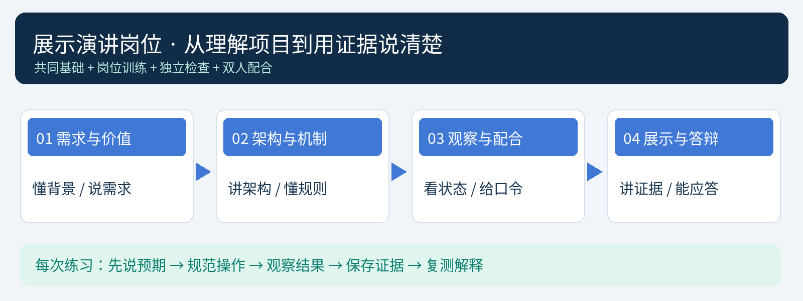

# 参赛学生B学习手册：展示演讲

RoomGuard V2 楼宇房间环境监测与异常声光告警系统

姓名：____________　学校：____________　搭档A：____________　指导教师：____________

这本手册给负责展示演讲的你使用。你的任务是让评委看懂“为什么做、怎样工作、操作证明了什么、还有哪些边界”。讲得流畅要建立在真实理解和观察上，不能只背PPT。

你需要亲手完成基础页面操作、查看在线与历史，并在教师安排的练习权限下做一次确认／本次消音。复杂装配和烧录由A主责，但你要说得清流程、能识别错误。与教师36学时计划配套，先理解，再练语言，最后计时。

## 一、你的岗位与学习方法

你负责：组织背景与痛点、讲架构与机制、指示实物和界面、给A下清楚口令、观察真实状态、解释结果、时间控制、答辩与复盘。A负责设备准备和主要操作；教师负责电气核准、全局权限及接入批准等安排。

不要连续说话压住操作。按“说明目标→给口令→等动作→看结果→作解释”的节奏；动作未结束不急着翻页。你应确认“哪一间房、哪一种原因、哪一个事件、当前处于哪一步”。

学习四步：先用一句话说核心意思；对着实物指出证据；脱离原稿换自己的话讲；让A追问一个为什么。每次只练2—3页，录音后删掉重复词和没有证据的结论。

八个关卡：认识项目→理解背景→读懂架构→看懂界面→解释告警→配合操作→回答追问→计时上台。每关目标不是背完整段，而是能在换问题时仍讲准确。

## 二、你必须掌握的基础，不用讲成术语堆

### 1. 一分钟认识项目

我们的节点在两个房间采集环境状态，101用ESP32、102用ESP8266。温湿度展示；烟雾或火焰触发该房间本地声光。数据经2.4GHz局域网进入Pi3B，服务器保存记录并供电脑、手机、大屏查看。教师可以管理设备、参数、服务和显示方案。

三个关键词：现场独立、中心管理、多端同步。现场独立不是节点永不出错，而是本地判断不依赖网络；多端同步也不是每个屏幕同一毫秒变化，而是它们从同一服务器取得状态。

### 2. 十个术语的学生版解释

| 术语 | 你怎样讲 | 对应实物／界面 |
| --- | --- | --- |
| 节点 | 一个房间里的采集与报警单元 | ESP、传感器、声光模块 |
| 路由器 | 连接局域网设备，转发信息 | MW305R，不是数据存储中心 |
| 树莓派服务器 | 收集、存储、处理并提供访问 | Pi3B与Web服务 |
| MQTT | 节点与服务器交换状态和指令的消息方式 | 1883端口，节点独立账号 |
| Web | 终端访问界面与管理功能的入口 | 本项目8080端口 |
| AO | 随响应变化的模拟电压 | MQ相对响应与曲线 |
| DO | 跨过阈值后的开关状态 | 烟雾／火焰触发输入 |
| 设备ID | 用于识别某块板，MAC派生 | 教师设备列表 |
| 房间号 | 管理者绑定的位置标签 | 101、102卡片 |
| AP配网 | 手机连ESP热点填网络配置 | 192.168.4.1配置页面，不是OTA |

DHT11是有时序的数据协议，不能与普通开关DO混淆。AO未标定不能称精确ppm；火焰模块受光源与环境影响。5V模块的信号必须经过已核验适配，ESP32和ESP8266不能互刷同一BIN。

### 3. 四句话说对告警

温湿度仅展示；烟雾或火焰任一触发，两个原因可同时显示。确认只表示已阅。本次消音停止当前蜂鸣，但异常和红灯保留，新增原因或新事件重新鸣叫。全部原因恢复并连续稳定N秒才解除。

默认常规上报5秒，对应约20秒离线；若实际生效上报周期改变，离线门限按4倍且至少20秒调整。页面默认约2秒查询，本地烟火判断不必等待这两种周期。

## 三、学会讲背景、痛点和效益

### 1. 从具体场景开始

你可以这样理解：一栋楼有多个房间，管理人员不可能同时在每间房。仅靠走到现场查看，信息有间隔；发生异常时还需要知道位置、原因和是否处理。项目面向这种小规模教学与演示场景，把持续采集、就近提醒、集中查看和记录整合起来。

不要说“行业完全没有监测系统”。可以说“针对我们的多房间教学场景，需要把这些功能贯通，并降低配置与维护门槛”。社会背景是解释需求，不是放未经核实的事故数字。

### 2. 痛点要对应具体功能

| 遇到的问题 | 我们的做法 | 能拿什么证明 |
| --- | --- | --- |
| 巡查有间隔 | 持续采集与本地声光 | 节点状态与本地测试 |
| 房间多、信息散 | 按房间与原因集中展示 | 101／102独立卡片与事件 |
| 通信失效时难判断 | 本地继续、中心标离线 | 明确中断条件的测试记录 |
| 新增设备配置繁琐 | 手机配网、教师批准、动态展示 | 接入流程与新卡片证据 |
| 处理过程难复盘 | 发生／确认／恢复与历史 | 时间线与CSV |
| 教师维护有门槛 | 指定服务与显示Web管理 | 后台操作与审计 |

### 3. 效益用三层说，不编数字

现场：增加就近声光提醒与房间定位。管理：把状态、确认和历史放到统一入口。教学：训练电子装配、网络、Linux、编程理解、调试与表达的完整过程。

没有测量就不说“成本下降50%”“事故减少80%”“可无限扩展”。原型不替代合规消防设施。软件构建通过与实物检测通过要分开说。

练习：用60秒讲“场景—问题—方案—证据”，让A指出哪句话没有依据并修改。

## 四、对着图和实物讲架构

指向传感器：“这里负责把房间状态转为可读信息。”指向ESP：“这里执行本地采集与烟火判断，直接驱动声光。”指向路由器：“这里提供局域网连接。”指向Pi：“这里保存、处理并提供管理与展示。”指向屏幕：“这里按权限查看和操作。”

接着补一句：“现场声光还有一条不经过服务器的本地支路，因此通信中断时仍应继续工作；前提是节点供电和本地功能正常。”

下行指令也要会解释：教师配置或当前事件消音从服务端发往节点，不能只看页面点了保存就宣布已应用，要看回执与实际状态。清单与卡片是动态的，但新传感器型号仍需新增驱动和协议支持。

架构练习：不看PPT画数据链，再让A随意遮住一个部件，你解释哪个环节受影响、哪一环节仍能工作。不要用“整个系统都停了”概括所有故障。

## 五、看懂界面，再开口描述

| 你看到的状态 | 应怎样说明 | 不能直接下的结论 |
| --- | --- | --- |
| 在线、有新有效数据 | 当前收到该节点上报 | 所有传感器永远正常 |
| MQ预热中 | 模块处于启动稳定阶段 | 空气一定安全或已检测正常 |
| DHT采集故障／无效值 | 温湿度采集未获得有效结果 | 当前温度是0℃ |
| 节点离线 | 超时未收有效上报，数据过期 | 房间已恢复正常 |
| 当前环境告警 | 看具体房间、原因与时间 | 整栋楼一定发生火灾 |
| 已确认 | 管理员已阅并有记录 | 异常已经消失 |
| 本次已消音 | 当前蜂鸣停，异常仍在 | 永久禁用报警 |
| 等待稳定解除 | 输入已恢复但尚需连续稳定 | 程序卡死或立即安全 |
| 配置待同步 | 期望值已存，实际应用未确认 | 节点已经按新参数工作 |
| 服务器连接中断 | 当前终端拿不到新状态 | 旧卡片仍绿所以没有异常 |

观察顺序：房间→在线与时间→预热／故障→原因→处置状态→回执／历史。曲线动画不是新数据证据；页面刷新2秒也不代表节点2秒测一次。

亲手练习：打开大屏和工作台，找101的最后更新时间；查询一次发生与恢复记录；在教师安排的操作员权限下做一次确认和本次消音；向A复述看到了哪些变化。

## 六、配合操作时，你要知道的流程

### 1. Arduino与接入流程

A选芯片对应工程和端口，验证、上传、串口读ID；手机连该ESP的加密配置AP，输入比赛Wi-Fi、Pi IPv4和接入码；有管理权限的人核对ID并批准；节点得到独立MQTT凭据并上线。房间在后台绑定，不是每个房间重新改源码。

配置AP地址192.168.4.1不是长期Pi地址。手机切回比赛Wi-Fi后才去看Pi界面。十分钟码绑定一台申请，待批准不等于在线。AP配网不等于无线更新固件。

### 2. 现场演示应选什么

主线优先：两个房间正常→101测试异常、102独立→确认／本次消音→撤输入、稳定恢复→查历史。根据赛程再选通信中断或新增节点，不能为了“功能多”塞入所有烧录、配网、维护和长时间测试。

只准备两个实体时，第三／第四节点扩展用明确标识的模拟与日志，不能讲成第三套实体已装配。OPPO后台必须有真机结果；没有结果就说明待验。PPT截图可能来自模拟，不代表现场所有功能都实测过。

### 3. 断哪一段，要叫什么

断WAN只说明无互联网，局域网可能还通；暂停MQTT是代理中断；阻断节点Wi-Fi或LAN才是对应通信中断。别把路由器“禁止上网”按钮自动说成局域网隔离，先由A和教师验证。

本版重连上报当前状态，不保证完整补传全部离线采样和事件。停止roomguard后其网页无法自救，维护留SSH路线；这类高影响操作不是每次台上演示的必选项。

## 七、对应现有PPT的20页学习与表达

以下对应V2现有24页PPT中的前20页主讲，21—24页是隐藏备页。参考时长合计约10分05秒，其中第18页约2分钟用于动作，实际按预热、回执和赛程排练调整，不保证所有功能都能塞进同一时段。

讲稿是练习样例：先理解关键词，用自己的话表达；所有“已完成／已通过”须以当天实物和记录替换。没有观测结果时不照读成功结论。A不需要每页操作，只在约定页动作。

### 第01页｜封面（参考20秒）

抓住关键词：项目名称、分工、问题。

练习讲法：“各位评委老师好，我们展示的是楼宇房间环境监测与异常声光告警系统。我负责方案讲解，搭档负责设备操作。接下来通过两个房间，说明现场怎样感知、怎样提醒，以及管理端如何定位和处理。”

指图与配合：指向项目名和搭档，不提前触发异常。

你要知道：一句话说明项目，不从堆硬件型号开始。

### 第02页｜社会背景：分散房间，需要持续关注（参考25秒）

抓住关键词：分散、持续、就近。

练习讲法：“在校园楼宇中，宿舍、教室和实训室分布分散，管理人员难以同时到场。因此，我们需要让环境状态持续可见，并在烟雾或火焰相关异常出现时，先给周围人员就近提醒。”

指图与配合：可指向楼宇示意，A保持设备稳定。

你要知道：这是场景分析，不是已测得事故统计。

### 第03页｜现实需求：现场、管理、教学，关注点不同（参考25秒）

抓住关键词：现场提醒、管理定位、教师易用。

练习讲法：“现场关心能否及时得到声光提醒；管理端关心异常在哪间房、是什么原因、是否已经处理；教师还需要容易配置和维护。我们用房间节点、集中服务和管理网页回应这三类需求。”

指图与配合：依次指三类使用者或内容卡。

你要知道：同一功能要说清服务谁。

### 第04页｜行业痛点：信息分散，接入与维护有门槛（参考25秒）

抓住关键词：巡查间隔、信息分散、配置维护。

练习讲法：“针对我们的小规模教学场景，重点问题是巡查存在间隔、房间信息分散，以及新增设备和维护有门槛。我们的做法是持续采集、按房间展示、本地保留报警能力，并把接入与日常管理放到网页。”

指图与配合：一项问题对应一项做法，不泛称所有行业都没有现成产品。

你要知道：痛点不是口号，要能指出实现功能。

### 第05页｜项目目标：感知、提醒、管理、扩展形成闭环（参考20秒）

抓住关键词：采集、处置、扩展。

练习讲法：“项目目标是让房间独立采集和提醒，中心统一查看与留存，管理者按权限处置；新增同类节点时，不再手工修改每个终端页面，而是走配网与批准流程。”

指图与配合：用手势串起四个动作。

你要知道：扩展说的是节点清单和已有协议，不是任意传感器自动驱动。

### 第06页｜系统架构：房间现场与教师中心协同（参考35秒）

抓住关键词：节点、局域网、Pi、终端。

练习讲法：“传感器把环境状态交给ESP，ESP一方面在本地判断烟火异常、直接驱动蜂鸣器和RGB，另一方面经路由器向Pi上报。Pi保存和处理数据，并向电脑、手机和大屏提供界面。配置与消音再按权限下发到节点。”

指图与配合：沿箭头指图，特别指出本地声光支路。

你要知道：路由器转发，Pi处理；不是Pi先批准每次本地报警。

### 第07页｜节点硬件：五类模块，各自承担明确任务（参考25秒）

抓住关键词：输入、输出、电平。

练习讲法：“每个房间有DHT11、MQ-2、火焰模块、有源蜂鸣器和RGB。温湿度只展示，烟火输入参与告警。MQ模块按要求供电，进入ESP的信号经过适配。MQ响应在未标定时只作相对量，不能当成准确ppm。”

指图与配合：让A指认模块，不带电改线。

你要知道：5V供电与3.3V信号接口是两个问题。

### 第08页｜通用程序：同一源码，两种芯片分别编译（参考30秒）

抓住关键词：同逻辑、分目标、运行时配置。

练习讲法：“ESP32与ESP8266使用同一套业务逻辑，但芯片架构不同，需要分别编译和上传，不能互刷一个BIN。同型号新增节点可以使用通用固件，再由手机填写网络和接入信息，房间由后台绑定。”

指图与配合：展示工程或流程，不必在这30秒内现场完成烧录。

你要知道：AP配网不是OTA，首次仍用USB上传。

### 第09页｜新增节点：配网、批准、绑定，终端自动出现（参考30秒）

抓住关键词：接入码、配网、批准、动态显示。

练习讲法：“管理者先生成有时效的单设备接入码；手机连接ESP配置热点，填写比赛网络和Pi地址；管理者核对设备ID并绑定房间，批准后发放独立凭据。服务器接纳该节点，各终端按显示方案自动出现卡片。”

指图与配合：有真实第三节点时配合演示；没有时明确使用流程图或模拟证据。

你要知道：待接入、已批准和在线是不同阶段。

### 第10页｜教师后台：让日常管理从命令行走向网页（参考30秒）

抓住关键词：设备、参数、账号、显示、维护。

练习讲法：“教师后台集中管理接入与停用、节点参数、学生权限、终端显示和指定服务。学生只操作授权节点，教师保管全局权限。后台降低日常操作门槛，底层网络或服务故障仍保留SSH恢复入口。”

指图与配合：可由获准管理者展示后台；不投屏密码和接入码。

你要知道：Web后台不是可执行任意系统命令的万能控制台。

### 第11页｜报警机制：现场判断先于网络通知（参考25秒）

抓住关键词：或关系、本地、双原因。

练习讲法：“本项目的温湿度只展示。烟雾或火焰任意一项触发，就启动对应房间本地声光；两者同时触发时保留两个原因。状态变化再上报中心，终端按收到的数据展示，而不是本地先等网络批准。”

指图与配合：对照“或”逻辑图，不提前施加输入。

你要知道：本地响应与终端可见延迟应分别测量。

### 第12页｜告警闭环：确认、消音、解除分开处理（参考25秒）

抓住关键词：已阅、本次静音、稳定恢复。

练习讲法：“确认表示管理员已看到，不能代表异常消失。本次消音停止当前蜂鸣，红灯和异常仍保留；新增原因或新事件会重新鸣叫。只有全部原因恢复，并连续稳定到设定时间，才解除并留下恢复记录。”

指图与配合：依次指三种状态，后面的实操将验证。

你要知道：发送按钮成功不等于节点实际已生效。

### 第13页｜断网与恢复：现场继续，中心明确标记（参考25秒）

抓住关键词：本地继续、中心离线、重连当前。

练习讲法：“通信中断时，只要节点仍有电且本地功能正常，声光判断应继续。中心超时后把该节点标离线并保留最后异常。恢复连接后重新上报当前状态；本版没有完整补传所有离线历史。”

指图与配合：只引用实际做过的中断类型，别把断WAN说成节点断网。

你要知道：默认5秒上报约20秒离线，周期改变门限也改变。

### 第14页｜自适应终端：新增节点，不再固定两张卡片（参考25秒）

抓住关键词：动态清单、统一数据、多端。

练习讲法：“网页、Windows连接器和手机界面都从同一服务器获取节点清单，统计、卡片和查询选项随已批准设备变化。新增同类节点不必重新打包每个终端；显示范围和分页方案仍由管理者控制。”

指图与配合：指卡片与统计；模拟截图要说明来源。

你要知道：动态显示不等于无限容量，需要逐步压测。

### 第15页｜终端设置：教师统一方案，本机保留必要授权（参考25秒）

抓住关键词：主题、字段、范围、声音。

练习讲法：“教师可以统一配置明暗主题、字号、显示字段、楼层房间范围和分页。终端周期性拉取方案。浏览器声音仍需本机点击启用，手机后台还受系统和网络影响，后台设置不能绕过这些条件。”

指图与配合：可展示一个事先确认有效的主题变化，等待拉取。

你要知道：显示过滤不是网络保密边界。

### 第16页｜数据价值：不只看当前，还能回看处理过程（参考25秒）

抓住关键词：历史、时间线、CSV。

练习讲法：“除了当前状态，系统记录采样、报警发生、确认、恢复以及节点上下线。我们可以按设备和时间查询并导出CSV，用于核对处理过程。房间变更也应保留记录当时的位置，避免回看时混淆。”

指图与配合：指出真实记录时间和事件，不用空表假装已有数据。

你要知道：确认记录不代替恢复记录。

### 第17页｜服务维护：可操作，但有边界、有记录（参考25秒）

抓住关键词：白名单、备份、审计、恢复。

练习讲法：“教师可以查看指定服务、日志和磁盘，执行受限维护与备份恢复，操作有记录。维护请求排队不代表已经完成；停止业务后网页可能断开，需要备用入口。因此比赛不随意停止唯一服务。”

指图与配合：说明维护流程即可，非必需不台上停服。

你要知道：数据库恢复不自动回滚MQTT密码文件。

### 第18页｜双人演示：一人操作，一人解释状态变化（参考120秒）

抓住关键词：口令、动作、观察、解释。

练习讲法：“下面进入演示。请先核对101和102的实体与页面。接着按预案对101施加测试输入，我会观察本地声光、终端房间和原因。随后分别确认和本次消音，最后撤去输入、等待稳定恢复，并查看记录。每一步以实际结果为准。”

指图与配合：按本手册下一章的分步口令执行；等待时只描述当前状态。

你要知道：120秒是参考，主线与选做场景按排练和赛程取舍。

### 第19页｜验证结果：软件证据与整机验收分开说明（参考25秒）

抓住关键词：构建、模拟、实物、待验。

练习讲法：“已有工程提供两平台编译、自动测试和软件集成证据。我们的本次实物结果，请看验收记录中的实际环境与结论。模拟数据、输入测试和真实检测分别标记；尚未完成的真机后台或电气项目，不写成已通过。”

指图与配合：换成你们真实的验收表，不照抄软件日志充当实测。

你要知道：本人贡献要具体，不能把所有辅助生成代码说成独立手写。

### 第20页｜项目效益：让现场有提醒，让管理有依据（参考20秒）

抓住关键词：现场、管理、教学、下一步。

练习讲法：“项目希望增加现场提醒，让房间状态与处置过程更清楚，也帮助我们训练装配、配置、测试和表达。下一步先完成尚待实机验证的项目，再完善离线记录与时间保持。我的汇报结束，请老师指导。”

指图与配合：恢复到明确状态，与A确认收尾，不留下测试异常。

你要知道：效益用有依据的事实表达，不虚构百分比。

## 八、演示口令：先等证据，再下结论

### 场景1：正常与位置

你说：“请核对两个房间的实体和页面。”A指认。你查看房间、在线、采样时间、预热和故障，再说实际观察到的状态。若仍预热，就说“该模块仍在预热，暂不把它当作就绪”。

### 场景2：101异常，102独立

你说：“请按预案对101施加测试输入。”A复述并执行。先看本地，再看页面；实际看到后说：“101出现____原因，本地____，终端____；102当前____。”句子里的空白由现场填写。

如果使用输入注入，说“我们用受控测试输入验证后端响应”；如果是模拟，说“现在展示模拟场景”；只有真实传感器检出才按实物测试描述。不把光学输入或软件状态夸大成真实火灾发生。

### 场景3：确认与消音

你说：“先确认，记录已阅。”观察记录后再说：“现在请求本次消音。”A操作后，你先看回执与蜂鸣，再说：“当前蜂鸣____，红灯和异常____。”若还未有回执，就说“正在等待节点确认”，不说已经停止。

### 场景4：稳定恢复

你说：“请撤去测试输入，观察稳定恢复。”A撤去。等待时解释连续稳定N秒的作用。看见恢复后说：“已达到本次设定的稳定条件，恢复记录____。”短暂正常又触发时应重新计时，不指责系统卡死。

### 选做场景：通信中断或新增节点

先说明具体中断方法或扩展证据来源，再请A执行；不要在台上临时设计断网方式。等待离线时说明默认门限或当前参数；只说观测到的状态。新增实体需要烧录、配网、批准，十分钟讲解内不一定全部做完；按赛程预先取舍。

### 当结果不一致

你说：“当前这一步尚未得到预期结果，我们先核对____。”给A短时间看一层证据。必要时说：“此项先保留为待查，我们恢复基础场景，再用已有记录说明验证范围。”不要拿旧截图冒充当前实时成功，也不要连续发出新指令让A失去顺序。

## 九、答辩练习：每题先结论，再原因，再证据

### 1. 为什么做这个项目？

参考：多房间场景信息分散、巡查有间隔，现场需要就近提醒，管理需要定位与记录。我们的系统把采集、本地报警、集中显示与教师管理串起来。证据可指向两房间独立状态和处理记录，不编社会事故统计。

### 2. 为什么本地报警不全放Pi？

参考：通信和服务器可能失效，现场不能只等远端指令。ESP直接判断并驱动声光；Pi负责集中数据与管理。用明确中断条件的本地测试说明，前提是节点仍供电且功能正常。

### 3. 温湿度为什么不报警？

参考：这是当前需求与首版范围，温湿度用于展示和历史；本版环境报警条件为烟雾或火焰。以后可评估扩展，但不能说当前已有温度阈值报警。

### 4. MQ数值是多少ppm？

参考：当前未完成定量标定，显示相对响应或换算电压，不给准确ppm结论。DO按模块阈值参与触发；传感器对多种气体有响应，不能等同选择性检测某一种气体。

### 5. 为什么有AO还要DO？

参考：AO便于连续观察趋势，DO便于读取跨阈值状态；两者提供的信息不同。进入ESP的电平和ADC量程要分别核验。

### 6. 为什么选有源蜂鸣器？

参考：内部有振荡源，用通断控制即可发声，适合明确告警。本模块低触发，具体驱动和电流要符合电路，不由GPIO直接承担任意负载。

### 7. 两种ESP能烧同一个文件吗？

参考：不能共用一个BIN；芯片架构不同。可以复用业务源码，同型号节点共用同型号通用固件，再运行时配置网络和位置。

### 8. 手机配置是否就是无线刷机？

参考：不是。AP配网改变网络、Pi地址和接入信息；OTA是无线更新固件，本版没有OTA，首次用USB与Arduino IDE。

### 9. 自适应怎样实现？

参考：设备按接入协议申请，管理者批准绑定，服务器动态保存清单，终端按清单和显示方案生成内容。已有同协议节点扩展不改每个页面；新传感器仍要驱动与协议改动。

### 10. 新设备能随便接入吗？

参考：有随机AP密码、短期单设备接入码、管理者核对批准和独立MQTT账号。仍只面向可信局域网，MAC标识不是硬件防伪，也没有提供公网TLS方案。

### 11. “确认告警”和“解除”有什么区别？

参考：确认只表示已阅；解除来自所有异常消失并连续稳定。再补充本次消音不清异常，新增原因可重新鸣叫，用实际事件时间线说明。

### 12. 网络恢复后历史全部回来吗？

参考：本版上报恢复后的当前状态，没有完整补齐所有断网历史。说明这是后续完善项，不把“自动重连”说成“没有数据丢失”。

### 13. 为什么有时20秒才显示离线？

参考：正常周期默认五秒，超时门限约四倍以容忍少量延迟。周期改变后按实际生效值计算，最低二十秒。终端还有查询与显示延迟。

### 14. 网页锁屏能响吗？

参考：普通网页后台可能暂停，不能保证。APK提供原生后台功能，但还需系统许可、网络和指定OPPO真机测试；断网或强停不保证新告警。不能把兼容API22当锁屏已通过。

### 15. Pi没有互联网和RTC怎么办？

参考：局域网业务可继续；时间需开机核对，可由教师Web或获准上位机校时，来源要正确。日历显示与单调超时分开，避免校时直接影响离线判断。

### 16. 后台能控制整个Linux吗？

参考：不能任意执行命令，只提供指定服务和受控维护。停止业务后需SSH／控制台恢复，保留权限与审计，不把方便操作说成无限权限。

### 17. 基板现在能直接制作吗？

参考：不能。已知每侧15针、针距2.54mm，排距、尺寸、脚序与孔位还需核验，当前PCB未布线，也未完成制造签核。

### 18. 你本人具体做了什么？

参考：按真实经历填“我理解并修改了____；整理了____；核对了____；做了____测试；发现并复测了____问题”。说明使用的已有工程与辅助工具，不把全部代码归为本人独立手写。

### 19. 为什么说这个系统有效？

参考：先限定验证范围，再给记录。例如“在这两节点、这套网络和此测试方式下，观察到独立告警、确认／消音／恢复与记录”。软件日志、模拟和实物分开，不推导出未经验证的大规模效果。

### 20. 还要怎样改进？

参考：先完成当前电气、Pi目标机、AP与OPPO实测，再评估离线缓存补传、RTC、容量和安全。改进计划说具体步骤与验收证据，而非只说“更智能”。

答不出来时可这样说：“这一点我们还没有足够验证，已知的实现是____；计划在____条件下，用____步骤检查，再以____结果判断。”不要凭空编数，也不把所有问题推给A。

## 十、遇到现场变化怎么讲

| 情况 | 你先说什么 | 然后怎么配合 |
| --- | --- | --- |
| 回执没到 | 当前请求已发，正在等节点确认 | 给A核对在线与事件，不先宣布消音 |
| 节点离线 | 该节点未继续上报，下面是最后数据 | 让A查供电／连接，保留最后异常 |
| 网页断开 | 当前终端取不到新的服务器状态 | 不继续把旧卡片当实时证据 |
| 仍在预热 | 模块尚未达到本次就绪条件 | 先讲架构，待就绪或明确待验 |
| 输入未触发 | 当前还没观察到该检测结果 | 核对受控测试方法，不自行加大危险刺激 |
| 声音没听到 | 声音链路尚待确认 | 区分节点蜂鸣、网页音效、APK后台 |
| 时间不足 | 先展示核心闭环，扩展用记录解释 | 不删掉必要恢复或突然跳到成功页 |
| 评委追问未验功能 | 当前结论限于____，此项待实测 | 给验证计划，不拿模拟冒充实物 |

## 十一、你的练习安排

第一轮懂原理：画架构，不看稿解释温湿度规则、AO／DO、确认／消音／解除与两芯片固件。过关要求是A换问法你仍答得对。

第二轮看界面：亲自找在线、时间、原因、回执和历史。A改变一个受控状态，你根据界面描述；不看状态就继续背稿算未通过。

第三轮练语言：每次2—3页，每页只记三个关键词和一个证据。录音检查语速、重复、指图和绝对化用词。稿中所有未完成数字与“已通过”圈出，核对来源。

第四轮配合：按口令演示，至少练一次等待回执、一次错误地址或离线情境。A反馈后再解释，不同时抢话或指挥两个相反动作。

第五轮计时答辩：按实际赛程取舍，每人接受独立提问。记录总时长、等待、切页与恢复时间；30分钟后台和两小时运行不在十分钟内假装完成。

你还应会的一分钟操作：打开工作台，指出101房间、在线和时间；在练习权限下查询历史并说明确认／恢复。你不必主责全部装配，但不能对真实界面完全陌生。

## 十二、上台前清单与个人贡献

□学校姓名正确。□PPT页序与时间清楚。□模拟／实物截图有标识。□每个结论有记录。

□我能用实物讲架构。□我知道当前异常的原因与阶段。□我会等A和回执。

□我能区分网页与APK后台。□我知道何处待验。□我准备了真实贡献说明。

□我会准确下口令。□我知道恢复与收尾。□我能独立完成基础界面操作。

我的30秒开场：________________________________________________

我的60秒架构说明：______________________________________________

最想展示的证据与来源：____________________________________________

我真实完成的工作与使用的辅助资料：__________________________________

尚待验证的项目与计划：____________________________________________

A给我的建议：____________；教师复核：____________；下轮改进：____________。
