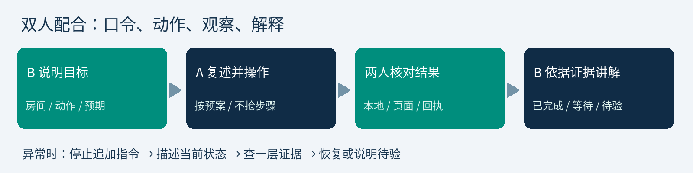

# RoomGuard V2 双人比赛配合随身卡

A：____________　B：____________　场次：____________　核心演示时限：____________

## 开始前，两人一起核对

□101=ESP32、102=ESP8266，实体与ID对应。□服务／代理可用。□节点在线、数据有效。

□时间正确、MQ就绪或明确预热。□参数实际生效。□网页声音／APK网络与许可符合本场计划。

□当前输入正常、无遗留测试。□备份与恢复路线准备。□截图注明模拟或实物。□口令与选做场景已约定。

## 演示主线

| 步骤 | B发口令 | A操作与反馈 | 看到后才能说 |
| --- | --- | --- | --- |
| 1 位置 | 请核对两个房间 | 指实体与卡片，报告当前状态 | ID、房间、在线与时间一致 |
| 2 触发 | 请对101施加预定测试输入 | 复述房间，执行受控方式 | 本地声光与页面具体原因 |
| 3 确认 | 先确认，记录已阅 | 当前事件确认，核对记录 | 已阅，不等于解除 |
| 4 消音 | 再请求本次消音 | 等回执、看真实蜂鸣 | 蜂鸣停，异常和红灯仍在 |
| 5 恢复 | 请撤输入，等待稳定 | 撤输入、等N秒、查恢复 | 满足本次稳定条件后恢复 |
| 6 记录 | 请核对这次事件 | 查发生／确认／恢复 | 实际时间线与证据 |

选做通信中断或新增节点时，先讲清方法和证据来源。只有两个实体时不把第三模拟节点说成实体；代理中断与Wi-Fi中断、断WAN分别描述。

## 出现意外，统一这样处理

A：“该步骤尚未确认，当前本地____、页面____，先查____。”

B：“我们先核对当前状态，不追加新动作。此项以实际记录为准。”

不能现场完成：恢复基础场景，保留待验项，用已标识记录解释，不用旧截图冒充实时结果。

## 结束四步

撤去输入并核对恢复→保存历史与备份→记录未解决事项→按预案正常关机。A报告状态，B确认不留测试异常。

始终分清：确认≠解除；消音≠永久静音；编译≠实物通过；模拟≠真实检出；AP配网≠OTA。
